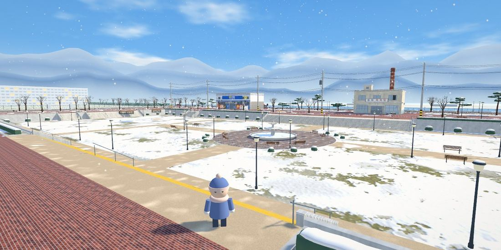
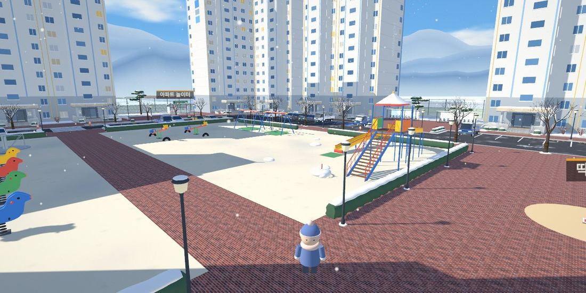
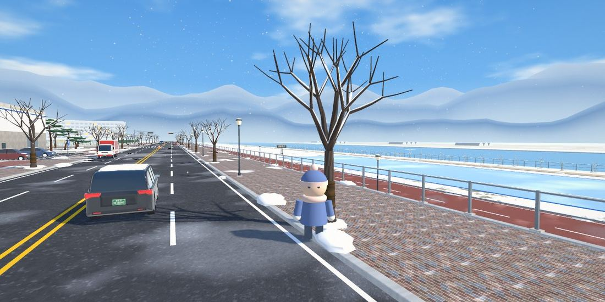
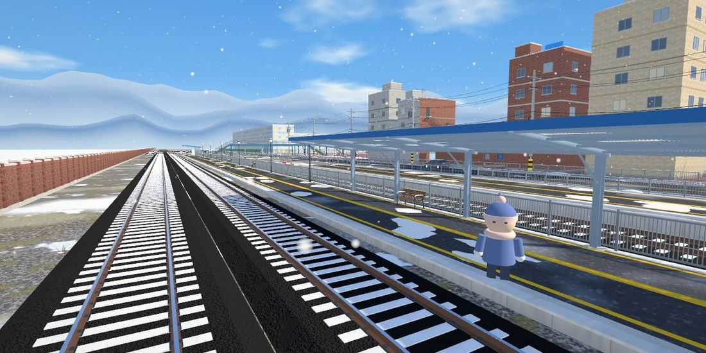
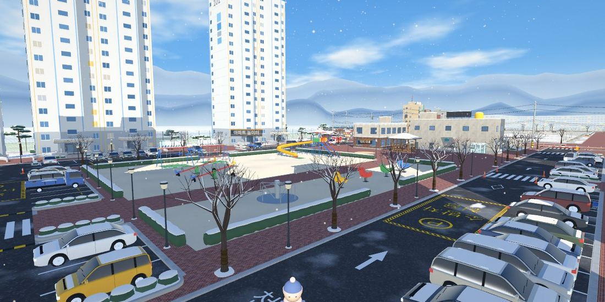

<div align="center">

# 꼬마야 꼬마야

**눈 오는 겨울방학, 우리 동네로 놀러 가자**

공원과 문구점, 놀이터에서 놀다가,<br>
지치면 강이나 역에서 쉬었다 집에 가자!

<br>

### [▶ 지금 바로 놀러 가기](https://kkoma.kkoma-server-cf.workers.dev)

설치 없이 브라우저에서 · 폰으로도 돼요

<br>




</div>

<br>

## 어떤 게임인가요

2000년대 어느 겨울방학, 오전 11시.
방학식이 끝나고 교문을 나서면 눈 덮인 동네가 기다리고 있어요.

아파트 놀이터에서 그네를 타고, 문구점 앞 오락기에서 한 판 하고,
공원에서 모르는 친구와 눈덩이를 굴려 눈사람을 만들어요.
그러다 지치면 강변 둔치에 나가 연을 날리거나, 간이역 벤치에 앉아 잠깐 쉬어 가요.

채팅은 없어요. 손을 흔들고, 같이 놀고, 같이 쉬면 돼요.
설치 없이 브라우저에서 바로 들어가고, 폰으로도 놀 수 있어요.
👉 **https://kkoma.kkoma-server-cf.workers.dev**

<br>

## 동네 둘러보기

<table>
  <tr>
    <td width="50%"><br><b>동화 아파트</b><br>놀이터의 그네 · 시소 · 뺑뺑이 · 미끄럼틀, 광장의 딱지 대결</td>
    <td width="50%"><br><b>강변</b><br>얼음 썰매장에서 별사탕 줍기, 둔치에서 연날리기</td>
  </tr>
  <tr>
    <td width="50%"><br><b>동화역</b><br>파란 대합 지붕 아래 벤치와 공중전화, 잔잔한 캐논</td>
    <td width="50%"><br><b>단지 한 바퀴</b><br>주차장의 초록 번호판 차, 동화상가와 주민센터, 정자</td>
  </tr>
</table>

<br>

## 이런 걸 하고 놀아요

| 놀이 | 이렇게 놀아요 |
|---|---|
| **함께 만드는 눈사람** | 여럿이 눈덩이를 굴려 보태면 몸통 열 개 · 머리 다섯 개로 눈사람이 완성돼요. 2분 뒤엔 녹아요 |
| **나눠바 나누기** | 둘이 막대 아이스크림을 반으로 쪼개요. 너무 세게 당기면 '뚝' |
| **딱지 · 공기놀이** | 마주 서서 딱지를 넘기고, 단계마다 공깃돌을 받아요. 혼자면 동네 형이 상대해 줘요 |
| **놀이터** | 그네 · 흔들 오리는 발 구르기, 시소는 둘이 힘을 모아서, 뺑뺑이는 여럿이 같이 |
| **문구점** | 오락기 '은하 대작전' · 벽돌 깨기, 가위바위보 기계, 뽑기로 가방에 다는 키링 |
| **동네 곳곳** | 엄마에게 거는 공중전화 콜렉트콜, 마을버스, 군고구마 · 호떡, 목욕탕 평상의 바나나우유 |
| **강변** | 얼음 썰매로 별사탕 줍기 기록 세우기, 얼레를 돌려 방패연 날리기 |

<br>

## 같이 놀기

- 동네는 **채널 다섯 개**로 나뉘어 있고, 한 채널에 **40명**까지 들어와요.
- 처음 들어가면 자리가 있는 채널로 알아서 들어가요.
- 같은 채널에 있는 사람끼리만 서로 보여요. 친구와 같이 놀려면 시작 화면이나 메뉴 › 서버에서 같은 채널 번호를 누르세요.
- 가득 찬 채널은 누를 수 없고, 연결이 잠깐 끊기면 같은 채널로 다시 붙어요.

<br>

## 조작

| | 데스크톱 | 모바일 |
|---|---|---|
| 이동 | WASD (Shift 달리기) | 화면 왼쪽 끌기 (끝까지 밀면 달리기) |
| 시점 | 마우스 끌기 · 방향키 | 화면 오른쪽 끌기 |
| 카메라 거리 | 휠 | 두 손가락 |
| 하기 · 놀이 보조 | E · R | E · R 단추 |
| 손 흔들기 | 1 | '손 흔들기' 단추 |
| 동네 지도 | M · 미니맵 누르기 | 미니맵 누르기 |
| 메뉴 · 그만하기 | Esc | 왼쪽 위 메뉴 |

메뉴에서 배경음 · 효과음 · 시점 감도 · 화질(자동 · 높음 · 보통 · 낮음) · 절전을 바꿀 수 있어요.

<br>

## 이렇게 만들었어요

- **전부 코드로**: 건물 · 차 · 나무 · 간판 같은 모델, 눈과 벽돌 텍스처, 배경음악까지 이미지 · 음원 파일 없이 코드로 만들었어요. 간판 · 상호는 모두 지어낸 이름이에요.
- **8비트 배경음악**: Web Audio로 합성해요. 동네는 새로 지은 잔잔한 곡, 역과 강가는 파헬벨 캐논을 돌림노래로 편곡했어요.
- **폰에서도 부드럽게**: 거리에 따라 단순한 모델로 바꾸고, 그림자는 단순 모델로만 그리고, 같은 소품은 묶어서 한 번에 그려요. 아이폰(화질 낮음)에서 동네 곳곳 56 ~ 60fps.
- **가벼운 배포판**: 소스와 Three.js를 한 파일로 묶어 약 350KB(gzip). 두 번째 방문부터는 텍스처를 브라우저에 보관해 더 빨리 들어와요.
- **무료 서버**: Cloudflare Workers 위에서 채널마다 Durable Object가 하나씩 돌며, 0.1초마다 모두의 위치를 나눠요. 게임 화면도 같은 곳에 정적 파일로 올렸고, 둘 다 무료 플랜이에요.
- **익명 통계**: 서버가 접속 수 · 놀이 횟수 · 화면 속도만 모아요. 운영용 `/stats` 표는 열쇠로 잠가 두고, 이름 · IP · 위치는 모으지 않아요.

<br>

## 직접 해 보기

```bash
# 개발판 (빌드 없이 바로)
run-local.bat              # Windows, 또는 ./run-local.sh → http://localhost:8000/

# 멀티플레이 서버 (선택, 채널 5개 × 40명)
cd server-cf && npm install && npm run dev   # Cloudflare판 → ws://localhost:8080
cd server && npm install && npm start      # 또는 Node판 (같은 주소)

# 배포판 만들기
cd tools && npm install && npm run build   # → dist/

# Cloudflare에 올리기 (처음 한 번: cd server-cf && npx wrangler login)
cd server-cf && npm run deploy             # 서버 → kkoma-server.….workers.dev
npx --prefix server-cf wrangler deploy --assets dist --name kkoma --compatibility-date 2025-10-01   # 화면 (저장소 폴더에서)
```

- `index.html?debug`: 콘솔의 `window.__town`, P로 성능 창
- `gallery.html`: 소품 갤러리

<details>
<summary><b>폴더 구조</b></summary>

```
index.html          시작 화면 · 메뉴 · 불러오기 표시
src/
  main.js           불러오기 단계 · 들어가기
  config.js         서버 주소(NET) · 링크(LINKS) · 글꼴 · 옷 색
  core/             엔진 · 카메라 · 입력 · 화질 · 절전 · 음악 · 효과음 · 재질과 텍스처
  map/              맵 (layout.js가 모든 좌표) · zones/ 아파트 · 공원 · 학교
  props/            소품 정의 (목록은 catalog.js)
  activities/       놀이 (registry.js가 E · R 행동을 고른다)
  entities/         캐릭터 · 다른 사람 · 차 · 노점 사람
  world/            배치 · 충돌 · 거리별 단순 모델 · 묶기
  net/              멀티플레이 · 익명 통계
  ui/               HUD · 메뉴 · 미니맵 · 시작 화면 · 성능 창(?debug)
server-cf/          멀티플레이 서버 (Cloudflare Workers + Durable Objects, 공개 배포용)
server/             멀티플레이 서버 Node판 (로컬 · 다른 호스팅) + shared.js(둘이 같이 쓰는 규칙 · 통계)
tools/              배포판 빌드 · 헤드리스 검수 도구
dist/               배포판 (빌드 결과 index.html · game.js, 이 폴더만 올린다)
dev/                개발용 페이지 · 음악 후보
docs/images/        README 스크린샷
```

</details>

<br>

## 고마운 분들

- **온라인산사** — 이 게임의 레퍼런스예요. Shout out to 온라인산사!
- [three.js](https://threejs.org) (MIT) · qrcode-generator (MIT) · ws (MIT) · esbuild (MIT)
- 글꼴: Google Fonts의 도현 · 나눔고딕과 간판용 한글 글꼴들 (각 글꼴의 오픈 라이선스)
- 음악: 파헬벨 '캐논'(저작권이 끝난 곡) 편곡, 그 밖의 곡은 직접 지었어요

<br>

<div align="center">

의견은 인스타 DM으로 보내 주세요 · [@clip_snow.town](https://www.instagram.com/clip_snow.town/)

</div>
